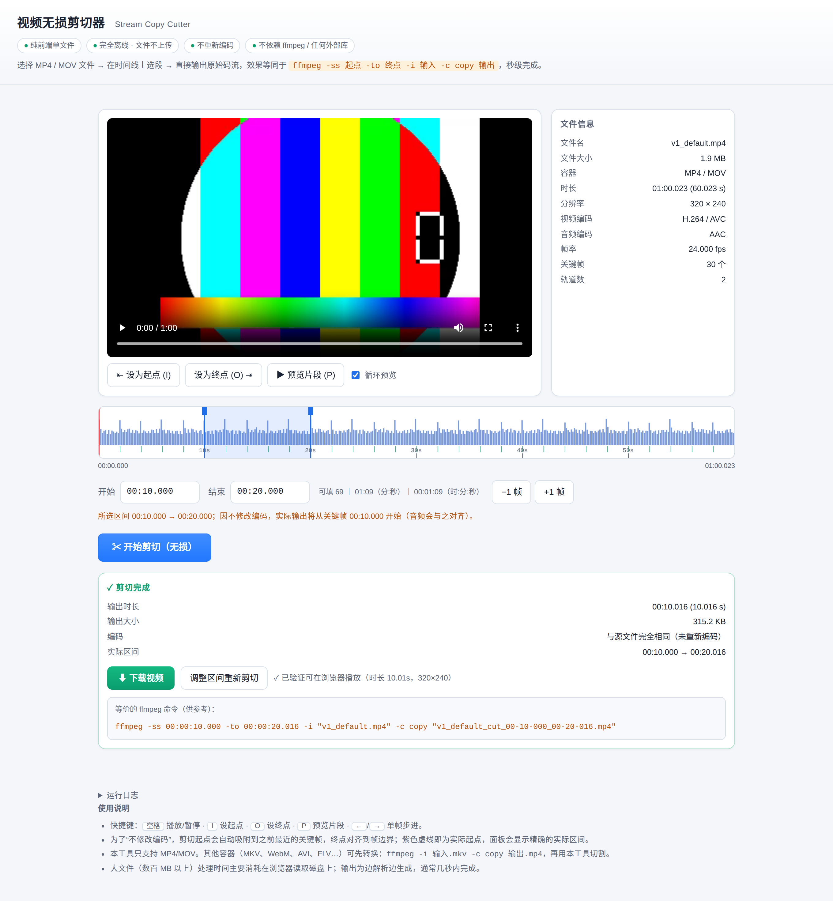
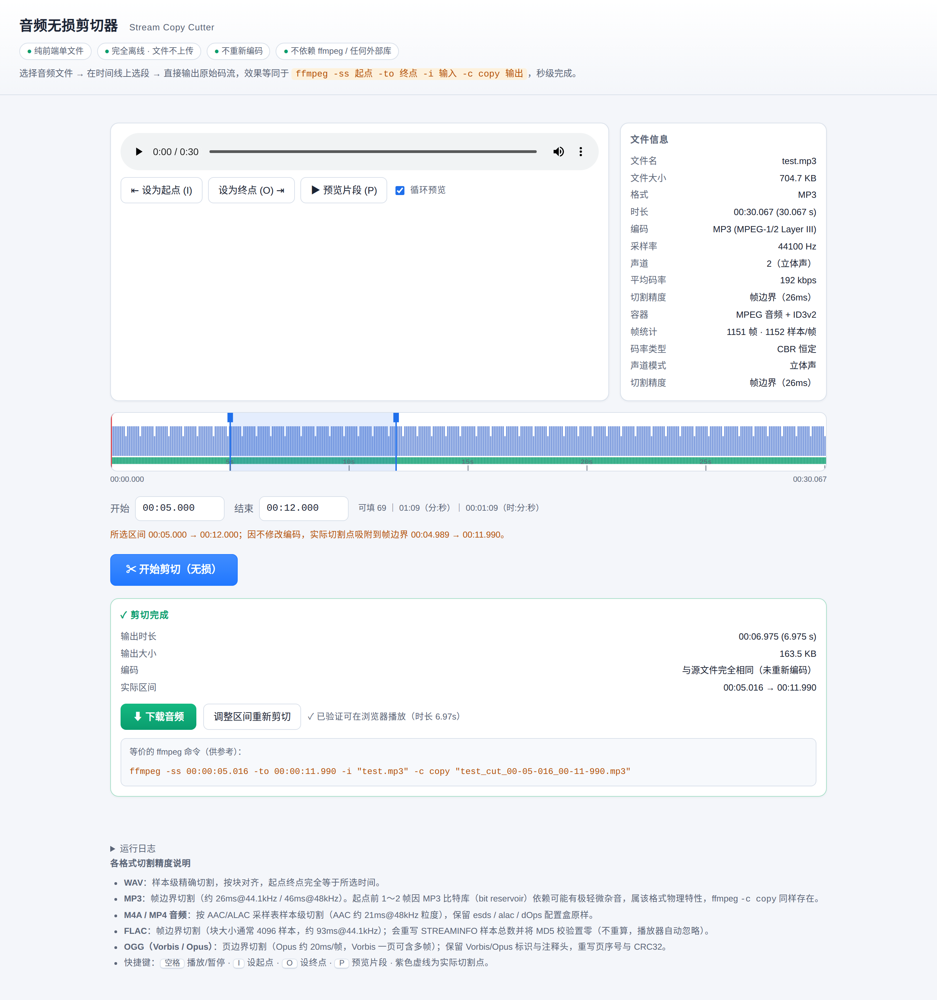

# 流拷贝剪切器 · Stream Copy Cutter

两个**零依赖、纯前端、完全离线**的单文件网页剪裁工具：视频版与音频版。
它们不重新编码，直接在容器层面搬运原始码流——画质/音质与源文件逐字节相同，速度只取决于磁盘。

| 单文件 | 体积 | 说明 |
|---|---|---|
| [`video-cutter/video-stream-cutter.html`](video-cutter/video-stream-cutter.html) | ~57 KB | MP4/MOV 关键帧对齐切割 |
| [`audio-cutter/audio-stream-cutter.html`](audio-cutter/audio-stream-cutter.html) | ~90 KB | WAV/MP3/M4A/FLAC/OGG 五种容器切割 |

双击打开即可使用：不上传、不联网、无任何 CDN 或第三方库。




## 功能

**视频版**
- MP4 / MOV / M4V 输入，H.264、HEVC、AV1 等任意编码（只做容器重组，与编码无关）
- 起点自动吸附到最近的关键帧，并如实回显"实际切割区间"
- 保留全部音轨（含多音轨），编辑列表（elst）按 B 帧重排延迟重写，保证起点从 0 开始
- 支持分片式 MP4（fMP4）：重写 `tfhd` 基址 / `trun` 偏移 / `mfhd` 序号
- 时间线波形由视频帧差异生成，可拖拽选区、逐帧微调、循环预览

**音频版**
- 五种容器、七种编码：WAV(PCM/float)、MP3(CBR/VBR)、M4A(AAC/ALAC/Opus)、FLAC、OGG(Vorbis/Opus)
- 波形时间线，自动吸附到格式的最小可切单元（MP3 帧 / FLAC 帧 / OGG 页）
- 完整保留元数据：ID3v2/ID3v1、Vorbis comment、FLAC 元数据块、MP4 音频参数
- 处理真实世界的"脏文件"：RF64、流式长度 0xFFFFFFFF、data 后置 chunk、奇数长度 chunk 的 pad、ID3 前缀的 FLAC、多音轨 M4A（自动只保留音轨）

## 支持矩阵

| 容器 | 编码 | 切割粒度 | 备注 |
|---|---|---|---|
| WAV / RF64 | PCM 8/16/24/32bit、float32/64 | 采样点（块对齐） | 输出统一为 RIFF；保留 LIST/fact 等块 |
| MP3 | MPEG-1/2/2.5 Layer III | 帧（26/48ms） | 重写 Xing/Info 帧计数；VBRI 标签抹除 |
| M4A / MP4(音频) | AAC、ALAC、Opus | 采样点（stts 重建） | 仅保留第一条音轨；fMP4 音频暂不支持 |
| FLAC | 16/24bit，任意采样率 | 帧（约 93ms@44.1k） | 重写 STREAMINFO 采样数、MD5 置零 |
| OGG | Vorbis、Opus | 页（约 1s Vorbis / 20ms Opus） | 重算 CRC32/MPEG-2、页序号、granule |
| MP4 / MOV(视频) | H.264 / HEVC / AV1 … | 关键帧 | 支持 fMP4；多音轨全保留 |

## 快速开始

```bash
git clone <this-repo>
open video-cutter/video-stream-cutter.html   # macOS
# 或直接双击 HTML 文件
```

拖入文件 → 拖动时间线选区（或输入时间）→ 点"开始剪切" → 下载。
时间输入支持多种写法：`69`（秒）、`01:09`（分:秒）、`00:01:09`（时:分:秒）。

## 原理

无损切割 = 解析容器索引 → 选出目标区间内的样本/帧 → 用原始字节重新拼一个容器头 + mdat。

- 视频：重建 `stts/stsc/stsz/stco/stss/ctts`，样本字节原样搬运；删除或重写 `edts`
- 音频：按格式分别重写 Xing、STREAMINFO、OggS 页头与 CRC
- 因为不触碰编码数据，输出与源在区间内**逐字节相同**，也就不存在"重新编码画质损失"

各格式的具体坑（B 帧重排、AAC 前导、页粒度、奇数字节对齐等）在各自的 README 中有详细说明。

## 测试

测试不依赖任何测试框架，只用 Python 标准库 + ffmpeg + Playwright。

### 视频版

```bash
cd video-cutter/tests
bash make_fixtures.sh          # 用 ffmpeg 生成 8 个测试视频（约 17MB）
python3 blackbox_test.py       # 7 种文件 → 浏览器切割 → ffmpeg 校验
python3 e2e_timeinput.py       # 时间输入解析回归
```

`blackbox_test.py` 的判定标准：输出可解码（零错误）、起点为 0、轨道齐全、时长在选区 ±GOP 内。
帧内容另用 `ffmpeg -f framemd5` 抽哈希核对与源文件逐帧一致。

### 音频版

```bash
cd audio-cutter
python3 test_cut.py            # 9 格式解析+切割 → ffprobe 时长 + 全量解码
python3 verify_content.py      # PCM 皮尔逊相关 + 能量比（验证切的是对的片段）
python3 supplement_test.py     # 多样化文件 / 边界参数 / 损坏文件 / 性能
python3 test_wav_roundtrip.py  # WAV 切割→下载→重新导入 + chunk 结构校验
python3 e2e.py                 # Playwright 全流程（9 文件）
python3 e2e_timeinput.py       # 时间输入解析回归
```

当前状态：以上全部通过（视频 7/7，音频各套 9/9）。

## 构建

音频版由 `src/*.js` 模块 + `template.html` 拼装：

```bash
cd audio-cutter && python3 build.py     # 产出 audio-stream-cutter.html
```

视频版是单文件直出工程（HTML 内联脚本），修改后直接用浏览器验证、用 `tests/` 回归。

## 已知限制（如实说明）

- **不重编码**：视频必须从关键帧开始，所以实际起点可能早于所选时间（面板会显示实际区间）；音频吸附到帧/页粒度
- MP3 帧边界切割在起点可能带入 1–2 帧比特库残留（有损格式固有，`ffmpeg -c copy` 同样存在）
- OGG/Vorbis 以页为单位（约 1s），极短选区会被扩展到整页
- FLAC 切割后 STREAMINFO 的 MD5 置零（标准允许，播放器自动忽略）
- 分片式 M4A（fMP4 音频）不支持；纯视频文件拖入音频版会明确提示
- 单线程浏览器内存模型：处理超大文件（>2GB）受浏览器 ArrayBuffer 上限约束

## 浏览器兼容

Chrome/Edge 80+、Firefox 74+、Safari 13.1+、iOS Safari 13.4+（依赖 ES2020 语法与 Pointer Events）。
不支持 IE。

## 目录结构

```
.
├── video-cutter/
│   ├── video-stream-cutter.html   # 成品（单文件）
│   └── tests/                     # 黑盒测试 + 夹具生成脚本
├── audio-cutter/
│   ├── audio-stream-cutter.html   # 成品（单文件）
│   ├── src/                       # 各格式解析器（UMD 模块）
│   ├── template.html              # UI 模板
│   ├── build.py                   # 内联构建
│   ├── test/                      # 测试夹具
│   └── *.py                       # 测试脚本
└── docs/screenshots/
```
